# HTTP Lab 1: Virtual Hosts

Práctica de servidores virtuales por nombre con Apache, utilizando dos máquinas virtuales con Vagrant: un servidor DNS (`ns1`) y un servidor web (`mercurio`).

**Autor:** Enrique Olmedo Muñoz

---


### 1.Comprobación del DNS

Desde la máquina DNS comprobamos que resuelve el servidor web:

`vagrant ssh dns -c "dig mercurio.olimpo.test +short"`

Desde la máquina web comprobamos que resuelve el servidor DNS:

`vagrant ssh web -c "dig ns1.olimpo.test +short"`


## 2. apolo.olimpo.test

### 2.1 DNS

Se edita `files/ns1.olimpo.test/olimpo.test.dns` y se añade el alias:

`apolo IN CNAME mercurio`

También se sube el serial del SOA de `1` a `2` para que BIND note el cambio.


`vagrant provision dns`

`
vagrant ssh dns -c "dig apolo.olimpo.test +short"
vagrant ssh web -c "dig apolo.olimpo.test +short"
`


### 2.2 Aprovisionamiento web

Los ficheros del sitio están en `files/apolo.olimpo.test/`: `apolo.html`, `apolo1.txt`, `apolo2.txt` y `messages/404.html`.

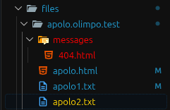

Se rellena `apache2-provision.sh` para copiar la configuración, habilitar el sitio y reiniciar Apache:

`cp /vagrant/files/mercurio.olimpo.test/apolo.olimpo.test.conf /etc/apache2/sites-available/
a2ensite apolo.olimpo.test.conf
systemctl restart apache2`

`vagrant provision web`

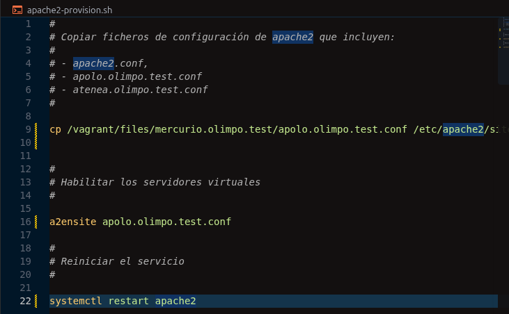

### 2.3 Virtual host

Se crea `files/mercurio.olimpo.test/apolo.olimpo.test.conf`:

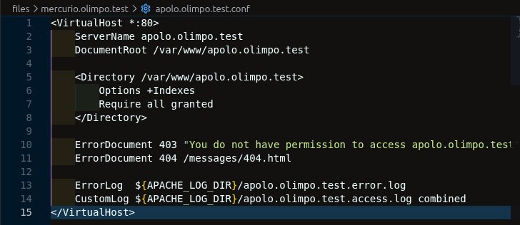

`vagrant ssh web -c "sudo apache2ctl configtest"`

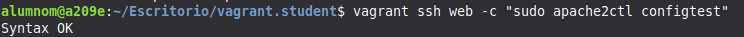

### 2.4 Verificación

Listado del directorio (`/`):

`vagrant ssh web -c "curl -i http://apolo.olimpo.test/"`

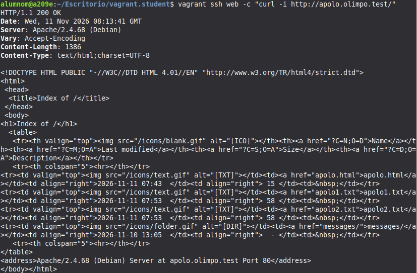

Recurso concreto (`/apolo.html`):

`vagrant ssh web -c "curl -i http://apolo.olimpo.test/apolo.html"`

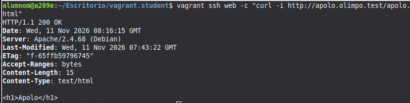

Recurso inexistente (`/index.html`), error 404 personalizado:

`vagrant ssh web -c "curl -i http://apolo.olimpo.test/index.html"`

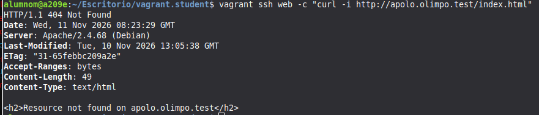

Página de error (`/messages/404.html`):

`vagrant ssh web -c "curl -i http://apolo.olimpo.test/messages/404.html"`

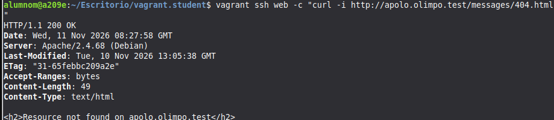

Logs del sitio:

```bash
vagrant ssh web -c "ls /var/log/apache2 | grep apolo"
```

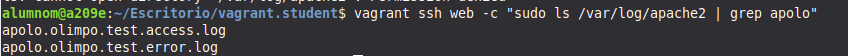

## 3. atenea.olimpo.test

### 3.1 DNS

Se edita `files/ns1.olimpo.test/olimpo.test.dns` y se añade el alias:

`atenea IN CNAME mercurio`

Se sube el serial del SOA de `2` a `3`.

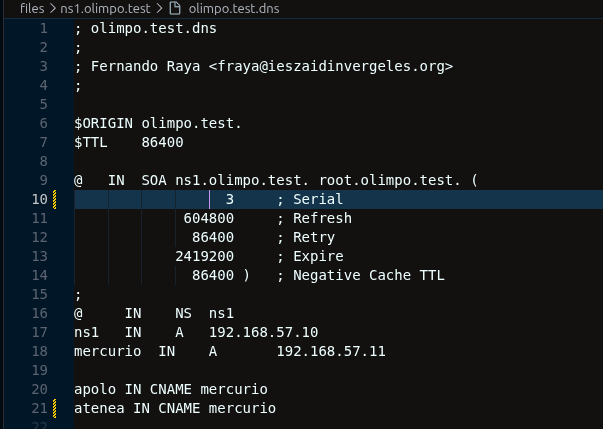

`vagrant provision dns
vagrant ssh dns -c "dig atenea.olimpo.test +short"
vagrant ssh web -c "dig atenea.olimpo.test +short"`

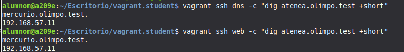

### 3.2 Aprovisionamiento web

Ficheros en `files/atenea.olimpo.test/`: `atenea.html`, `atenea1.txt`, `atenea2.txt` y `messages/404.html`.

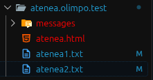

Se añade al script de provisioning:

`cp /vagrant/files/mercurio.olimpo.test/atenea.olimpo.test.conf /etc/apache2/sites-available/
a2ensite atenea.olimpo.test.conf`

`vagrant provision web`

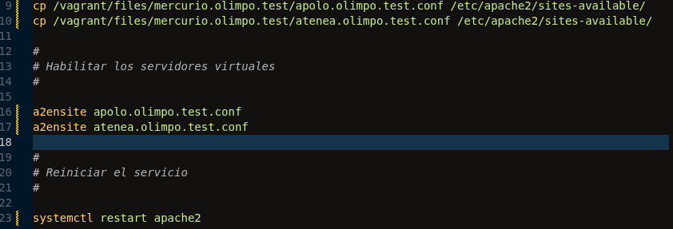

### 3.3 Virtual host

Se crea `files/mercurio.olimpo.test/atenea.olimpo.test.conf`. La diferencia con apolo es `Options -Indexes`, que provoca el 403 al pedir un directorio:

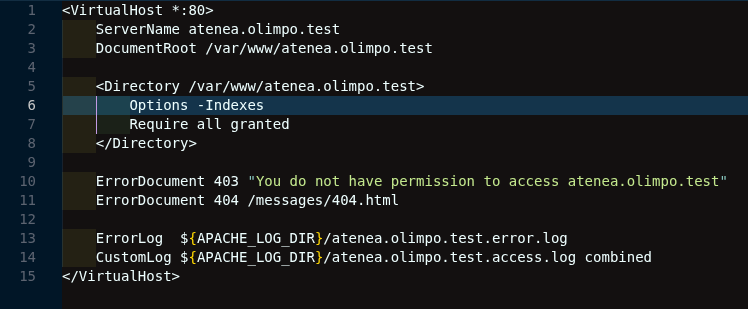

### 3.4 Verificación

Recurso concreto (`/atenea.html`):

`vagrant ssh web -c "curl -i http://atenea.olimpo.test/atenea.html"`

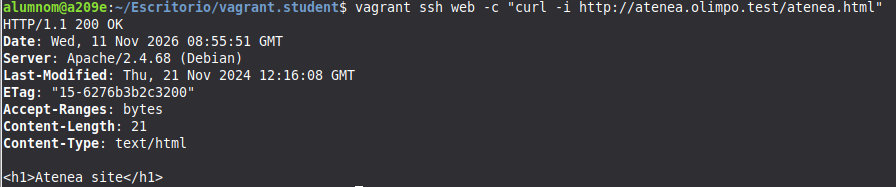

Directorio raíz (`/`), error 403:

`vagrant ssh web -c "curl -i http://atenea.olimpo.test/"`

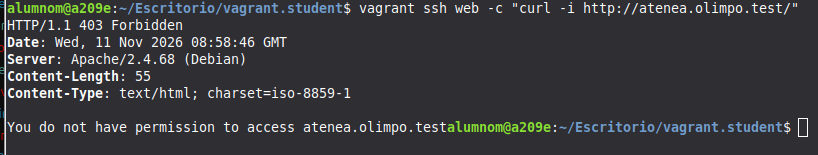

Recurso inexistente (`/index.html`), error 404:

`vagrant ssh web -c "curl -i http://atenea.olimpo.test/index.html"`

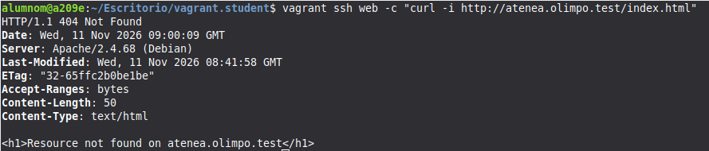

Directorio `/messages`, error 403:

`vagrant ssh web -c "curl -i http://atenea.olimpo.test/messages/"`

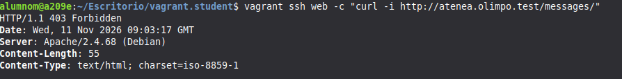

Logs del sitio:

`vagrant ssh web -c "ls /var/log/apache2 | grep atenea"`

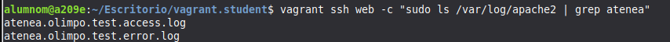

## 4. Ficheros entregados

`named.conf.local`, `db.olimpo.test`, `db.192.168.57`, `apolo.olimpo.test.conf`, `atenea.olimpo.test.conf` y `Vagrantfile`.