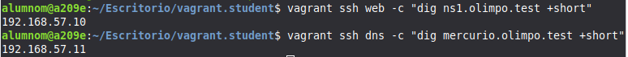
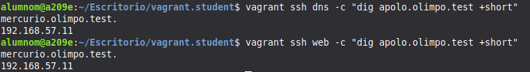

# HTTP Lab 1: Virtual Hosts

Práctica de servidores virtuales por nombre con Apache, utilizando dos máquinas virtuales con Vagrant: un servidor DNS (`ns1`) y un servidor web (`mercurio`).

**Autor:** Enrique Olmedo Muñoz

---

### 1.Comprobación del DNS

Desde la máquina DNS comprobamos que resuelve el servidor web:

`vagrant ssh dns -c "dig mercurio.olimpo.test +short"`

Desde la máquina web comprobamos que resuelve el servidor DNS:

`vagrant ssh web -c "dig ns1.olimpo.test +short"`

## 2. apolo.olimpo.test

### 2.1 DNS

Se edita `files/ns1.olimpo.test/olimpo.test.dns` y se añade el alias:

`apolo IN CNAME mercurio`

También se sube el serial del SOA de `1` a `2` para que BIND note el cambio.

`vagrant provision dns`

`
vagrant ssh dns -c "dig apolo.olimpo.test +short"
vagrant ssh web -c "dig apolo.olimpo.test +short"
`

